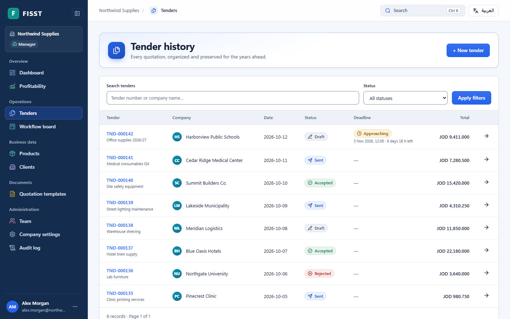
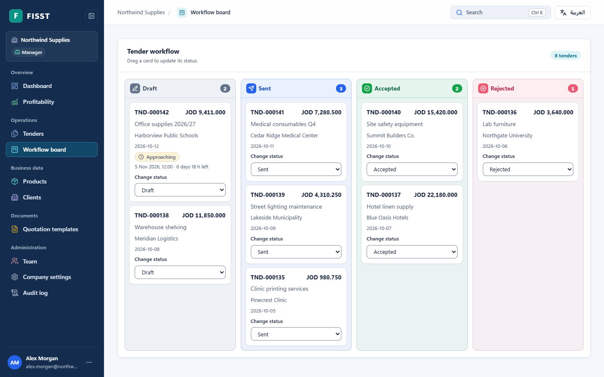
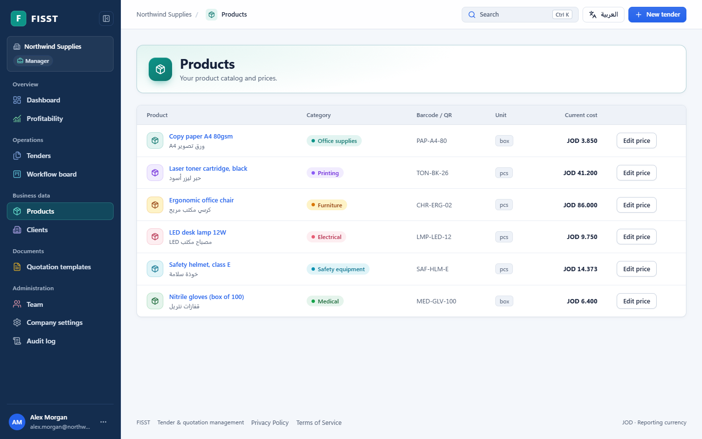
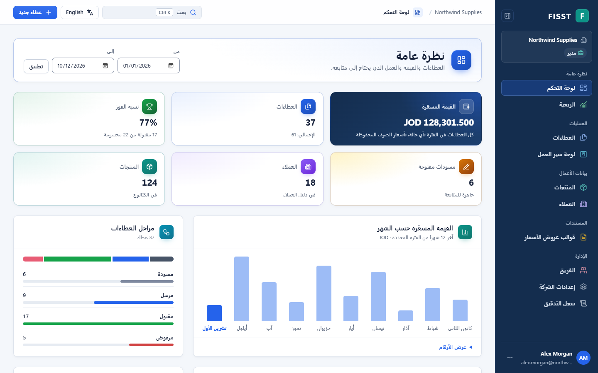

# FISST — Tender & Quotation Management SaaS

**A multi-tenant web platform that takes suppliers from first price list to final quotation: tenders, products, clients, workflow and professional bilingual documents in one place.**

## Overview

FISST is a multi-tenant SaaS application for companies that bid on tenders and send quotations. Each company gets its own isolated workspace where its team can:

- maintain a **product catalog** and a **client directory**,
- build **tenders** line by line with cost, offer price and profit per item,
- move tenders through a **workflow board** (Draft → Sent → Accepted / Rejected),
- export finished **quotations to Word, PDF and Excel** on the company's own letterhead,
- track performance on a **dashboard**,

all in **English or Arabic**, with full left-to-right and right-to-left layouts.

## Screenshots

> All screenshots show the real application UI rendered locally with **fictional sample data** (company "Northwind Supplies" and invented clients). No customer data is shown.

| | |
|---|---|
| **Dashboard** — KPIs, monthly quoted value, status pipeline  | **Tender history** — search, filters, status and deadline badges  |
| **Quotation editor** — line items with cost, offer price, profit and currency toggle  | **Workflow board** — drag-and-drop Kanban by tender status  |
| **Products** — bilingual catalog with categories, codes and prices  | **Clients** — client directory with contact details  |
| **Arabic / RTL** — the full interface mirrored for right-to-left use  | |

## Key Features

**Tenders & quotations**
- Tender numbering with company prefixes, optional titles and four statuses: Draft, Sent, Accepted, Rejected
- Line-item editor with quantity, original cost, offer price, per-line profit and margin
- Unit prices with up to 7 decimal places and currency-correct rounding of totals
- Quotation currency selection with saved exchange rates
- Submission deadlines with urgency badges
- Automatic draft saving and saved versions of each tender
- Quick-add of new products and clients without leaving the tender

**Workflow**
- Kanban workflow board with drag-and-drop status changes
- Tender history with search, status filters and pagination
- Global search (Ctrl K) across the workspace

**Catalog & clients**
- Product catalog with categories, Arabic and English names, codes/barcodes and camera barcode scanning
- Client companies with up to five contact persons each
- Client import from Excel spreadsheets

**Documents**
- Quotation export to **Word (.docx)**, **PDF** and **Excel (.xlsx)**
- Company letterhead templates (PDF and Word), including native PDF rendering of Word letterheads
- Arabic and English documents with correct right-to-left typography

**Insights & administration**
- Dashboard with quoted value, win rate, status pipeline, recent tenders and top clients
- Profitability report
- Team management with roles (Manager, Employee) and fine-grained permissions, plus email invitations
- Audit log of important changes
- Platform console for the Super Admin to manage companies, protected by multi-factor authentication

**Security**
- Bot protection on public forms (Cloudflare Turnstile)
- Rate limiting and a strict Content Security Policy

## Technology Stack

| Layer | Technology |
|---|---|
| Framework | **Next.js 16** (App Router, Server Components, Route Handlers) |
| UI | **React 19**, **TypeScript**, custom CSS design system (no CSS framework), Lucide icons |
| Backend & data | **Supabase** — **PostgreSQL** with **Row Level Security**, Supabase Auth and Storage |
| Validation & numbers | Zod schemas, decimal.js for exact money arithmetic |
| Documents | docx (Word), pdf-lib + fontkit (PDF), ExcelJS (Excel), pdf.js and sharp for rendering |
| Testing | Vitest (unit/integration, PGlite in-memory Postgres), Playwright (browser), axe-core (accessibility) |
| Hosting | **Vercel** |

## Engineering Highlights

- **Tenant isolation by design** — every company's data is separated at the database level with PostgreSQL Row Level Security, not only in application code, so one workspace can never read or change another's records.
- **Authentication and role-based access control** — company roles and granular permissions (for example who can see costs and profit or edit catalog prices) are enforced on the server and in the database, with a separate, MFA-protected platform administration area.
- **Document generation pipeline** — the same quotation model produces Word, PDF and Excel output, applies uploaded company letterheads, and renders Arabic text correctly in every format.
- **Bilingual RTL/LTR product** — the entire interface and every generated document work in English and Arabic, including mirrored layouts and mixed-direction content such as product codes and phone numbers.
- **Careful data modelling for money** — exact decimal arithmetic, per-currency rounding rules, saved exchange rates and versioned tenders keep quoted totals reproducible over time.
- **Quality gates** — an extensive automated test suite (unit, database, browser and accessibility tests) runs against isolated local databases.

## Live Demo

A public demo is not available yet. A link will be added here once a demo environment with sample data is ready.

<!-- Demo: https://… (add when available) -->

## Project Status

FISST is currently in private pilot testing and active development.

## Source Code

The source code is proprietary and maintained in a private repository.

---

© 2026 Hummam Yassin. Screenshots and this README are shared for portfolio purposes only.
