# FISST — Tender & Quotation Management SaaS

**A multi-tenant web platform that takes suppliers from first price list to final quotation: tenders, products, clients, workflow, finance and professional bilingual documents in one place.**

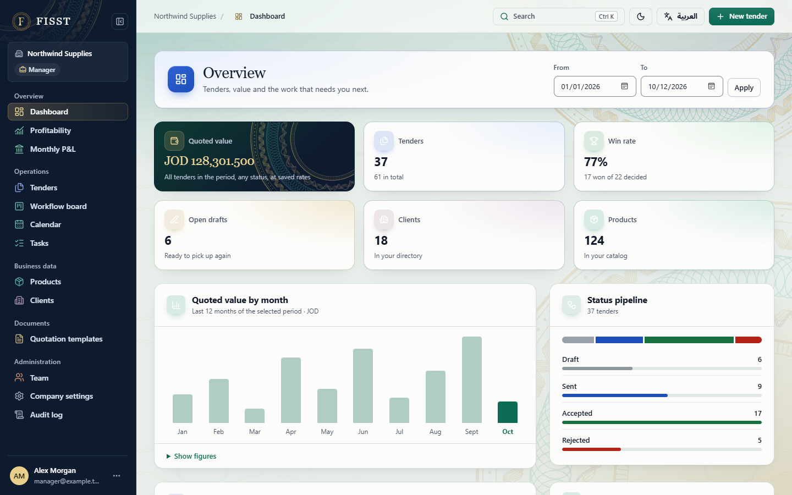

## Overview

FISST is a multi-tenant SaaS application for companies that bid on tenders and send quotations. Each company gets its own isolated workspace where its team can:

- maintain a **product catalog** and a **client directory**,
- build **tenders** line by line with cost, offer price and profit per item,
- move tenders through a **workflow board** (Draft → Sent → Accepted / Rejected),
- follow **deadlines on a calendar** and coordinate work with **team tasks**,
- export finished **quotations to Word, PDF and Excel** on the company's own letterhead,
- understand the business through a **financial dashboard and a monthly profit & loss report**,

all in **English or Arabic**, with full left-to-right and right-to-left layouts, in a **light or dark** theme.

## Screenshots

> All screenshots show the real application UI rendered locally with **fictional sample data** (company "Northwind Supplies" and invented clients). No customer data is shown.

| | |
|---|---|
| **Dashboard** — KPIs, monthly quoted value, status pipeline  | **Tender history** — search, sortable columns, status and deadline badges  |
| **Quotation editor** — line items with cost, offer price, profit and currency toggle 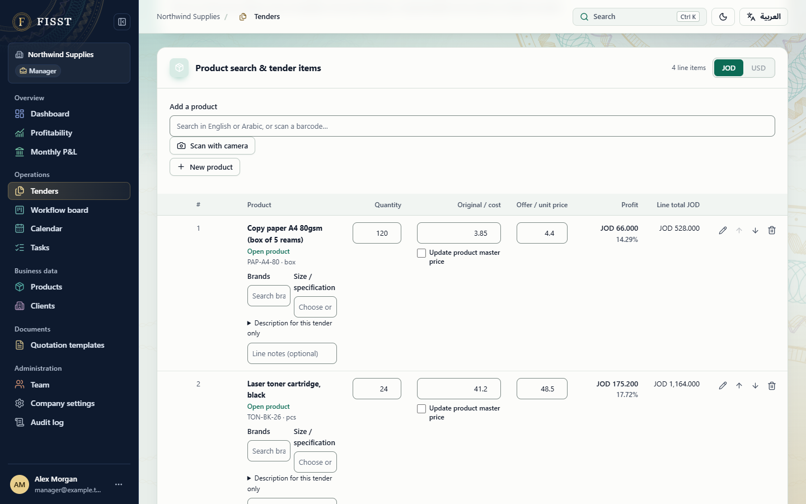 | **Workflow board** — Kanban by tender status  |
| **Calendar** — tender deadlines by month with status filters 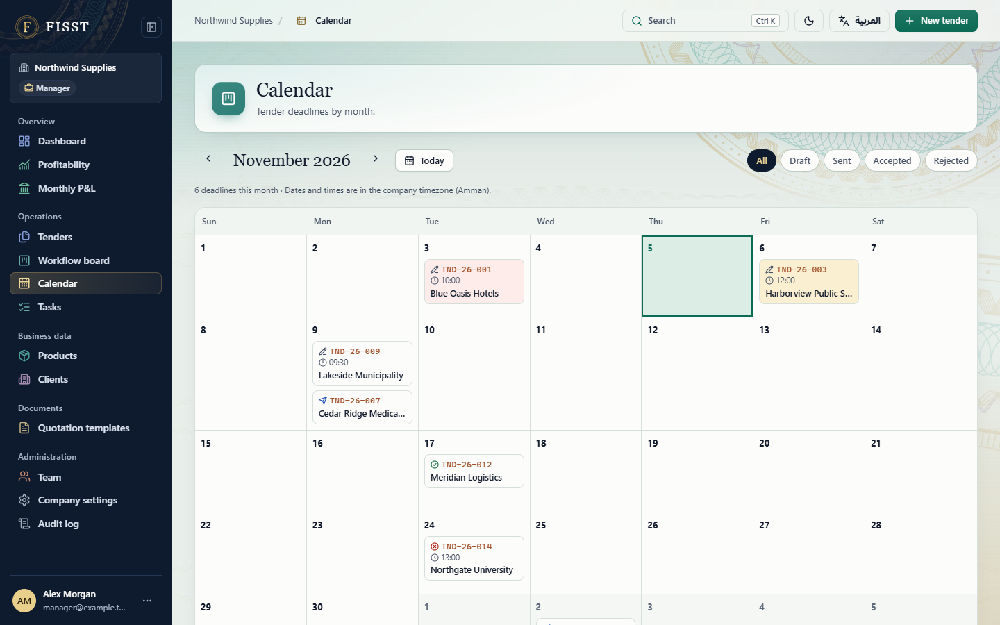 | **Team tasks** — assignees, priorities, due dates and overdue flags 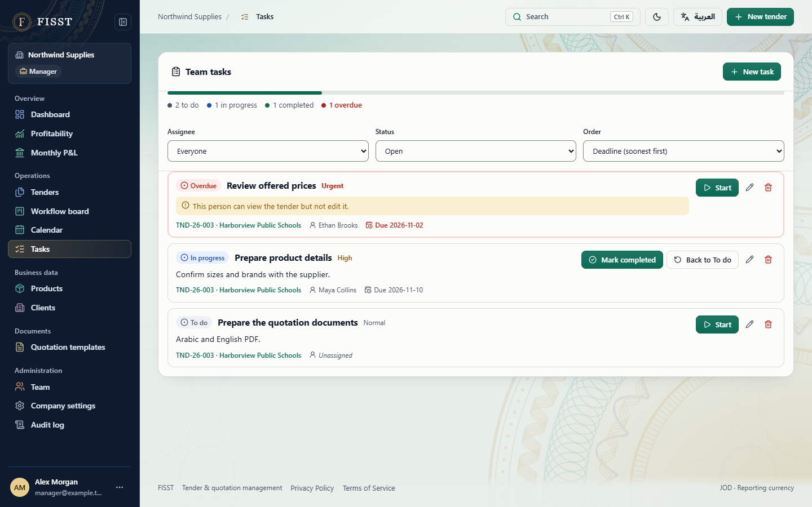 |
| **Financial overview** — accepted value, estimated profit, margin and win rate 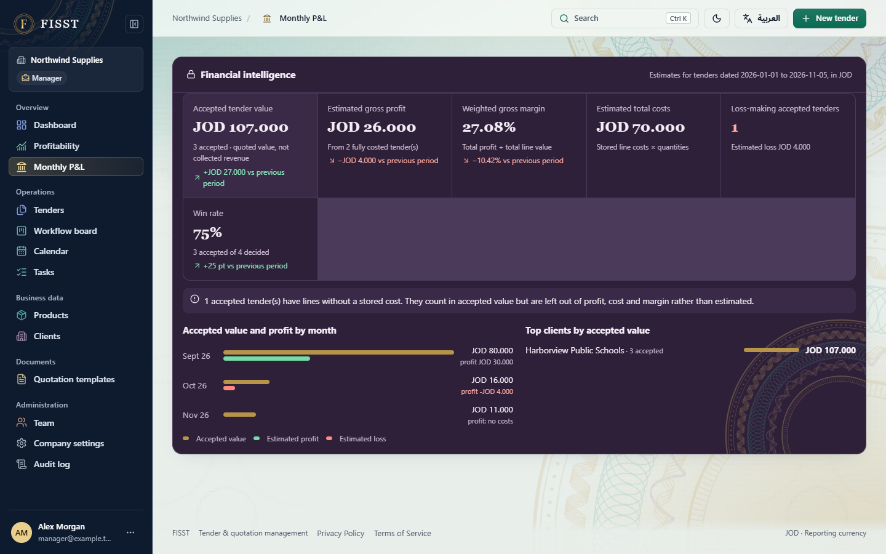 | **Monthly profit & loss** — revenue, costs, fixed expenses and month closing 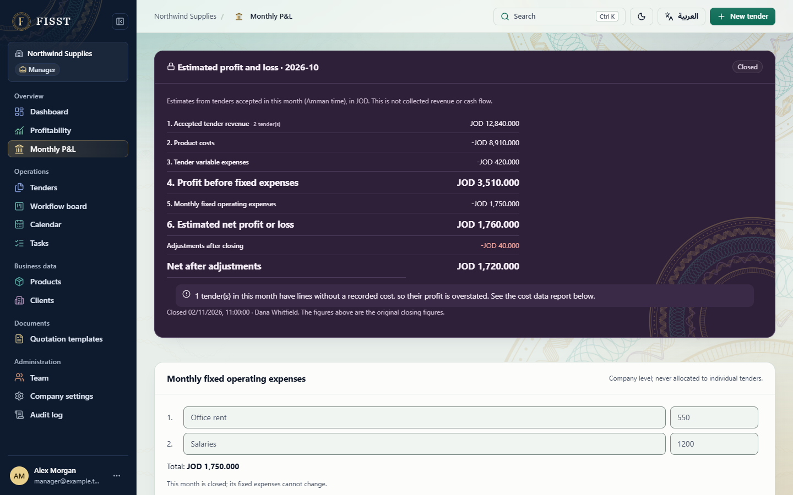 |
| **Products** — bilingual catalog with categories, codes and prices  | **Clients** — client directory with contact details 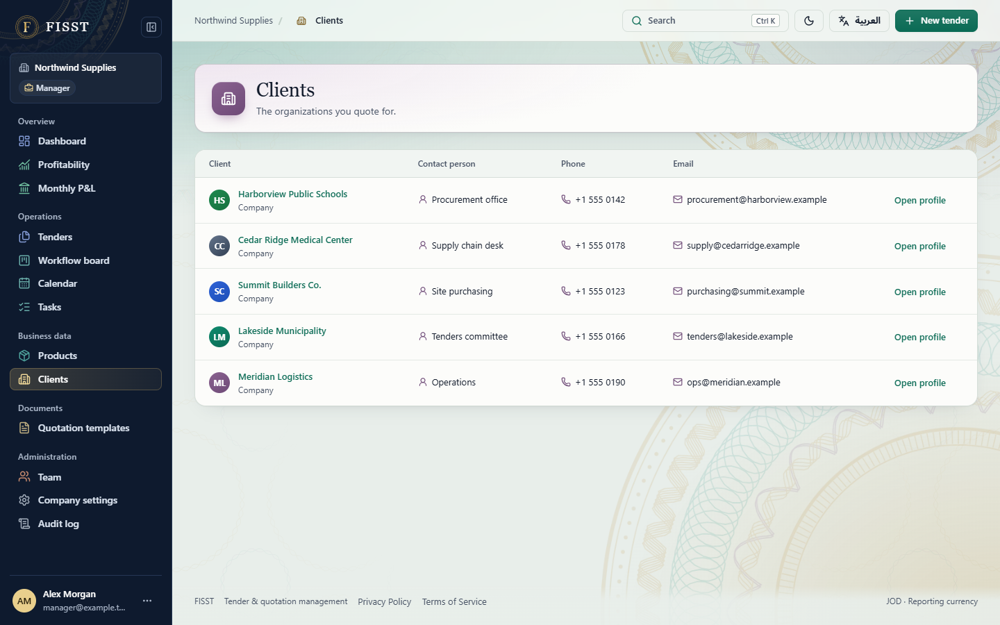 |
| **Arabic / RTL** — the full interface mirrored for right-to-left use 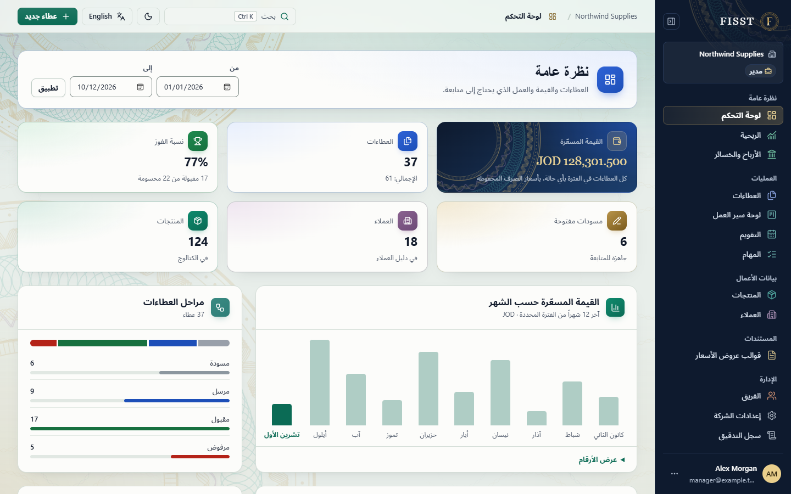 | |

### Dark mode

Every screen ships with a matching dark theme, chosen per user and remembered between visits.

| | |
|---|---|
| **Dashboard** 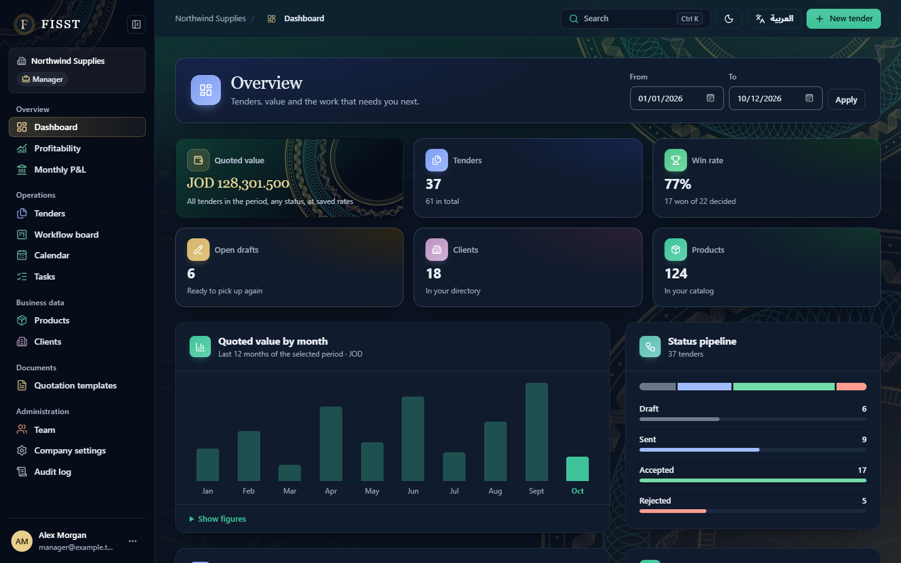 | **Tender history** 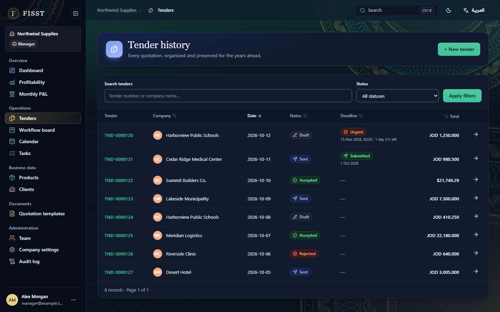 |
| **Workflow board** 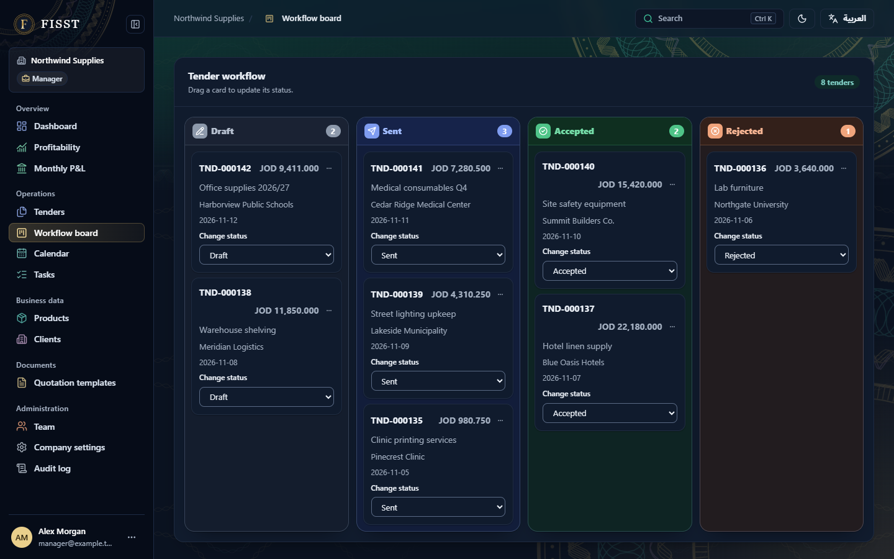 | **Deadline calendar** 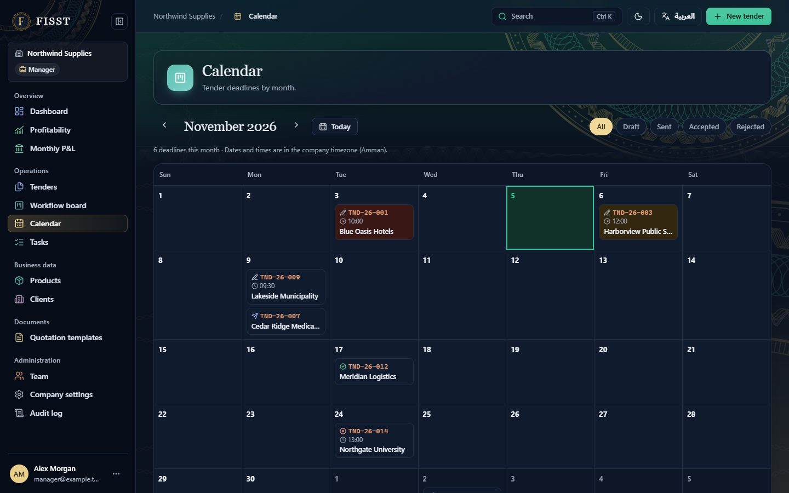 |
| **Monthly profit & loss** 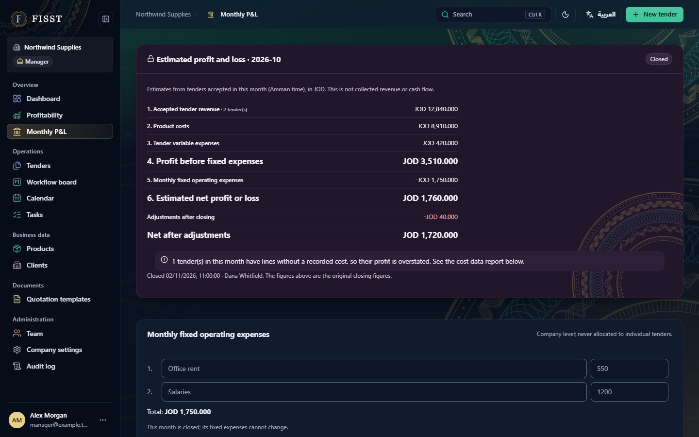 | |

## Key Features

**Tenders & quotations**
- Tender numbering with company prefixes, optional titles and four statuses: Draft, Sent, Accepted, Rejected
- Line-item editor with quantity, original cost, offer price, per-line profit and margin
- Unit prices with up to 7 decimal places and currency-correct rounding of totals
- Quotation currency selection with saved exchange rates
- Submission deadlines with urgency badges, plus a month-view **deadline calendar**
- Automatic draft saving and saved versions of each tender
- Quick-add of new products and clients without leaving the tender
- Permanent deletion of tenders (with confirmation), protection of accepted and sent tenders from accidental changes, and a warning before sending a tender that would sell below cost

**Workflow & teamwork**
- Kanban workflow board with status changes
- **Team tasks**: assign work to members, set priority and due date, track progress, and see overdue work
- Tender history with search, status filters, sorting and pagination
- Global search (Ctrl K) across the workspace
- In-app notifications and confirmations for key operations

**Catalog & clients**
- Product catalog with categories, Arabic and English names, brands, codes/barcodes and camera barcode scanning
- Product and client import from Excel spreadsheets
- Client companies with up to five contact persons each

**Documents**
- Quotation export to **Word (.docx)**, **PDF** and **Excel (.xlsx)**
- Company letterhead templates (PDF and Word), including native PDF rendering of Word letterheads
- Arabic and English documents with correct right-to-left typography and bidirectional text shaping

**Finance & insights**
- Dashboard with quoted value, win rate, status pipeline, recent tenders and top clients
- Financial overview with accepted value, estimated profit, weighted margin, loss-making tenders and period comparison
- **Monthly profit & loss**: revenue from accepted tenders, product costs, tender expenses, company fixed expenses, month closing and post-closing adjustments
- Profitability report and warnings when cost data is missing

**Team, security & administration**
- Company roles (Manager, Employee) with **granular, default-deny permissions** — for example who may see costs and profit, edit catalog prices, import data or delete records
- Team management with email invitations and member removal
- Audit log of important changes
- Platform console for the Super Admin to manage companies, protected by multi-factor authentication
- Bot protection on public forms (Cloudflare Turnstile), rate limiting, and a strict Content Security Policy
- Secure password reset

**Experience**
- English and Arabic interface with RTL/LTR layouts
- Light and dark themes with a custom visual identity
- Public landing page

## Technology Stack

| Layer | Technology |
|---|---|
| Framework | **Next.js 16** (App Router, Server Components, Route Handlers) |
| UI | **React 19**, **TypeScript**, custom CSS design system (no CSS framework), Lucide icons |
| Backend & data | **Supabase** — **PostgreSQL** with **Row Level Security**, Supabase Auth and Storage |
| Validation & numbers | Zod schemas, decimal.js for exact money arithmetic |
| Documents | docx (Word), pdf-lib + fontkit (PDF), ExcelJS (Excel), bidi-js for Arabic text, pdf.js and sharp for rendering |
| Testing | Vitest (unit/integration, PGlite in-memory Postgres), Playwright (browser), axe-core (accessibility) |
| Hosting | **Vercel** |

## Engineering Highlights

- **Tenant isolation by design** — every company's data is separated at the database level with PostgreSQL Row Level Security, not only in application code, so one workspace can never read or change another's records.
- **Authentication and role-based access control** — company roles and default-deny, granular permissions are enforced on the server and in the database, with a separate, MFA-protected platform administration area.
- **Document generation pipeline** — the same quotation model produces Word, PDF and Excel output, applies uploaded company letterheads, and renders Arabic text correctly in every format.
- **Bilingual RTL/LTR product** — the entire interface and every generated document work in English and Arabic, including mirrored layouts and mixed-direction content such as product codes and phone numbers.
- **Careful data modelling for money** — exact decimal arithmetic, per-currency rounding rules, saved exchange rates, versioned tenders and monthly closing keep quoted and reported figures reproducible over time.
- **Quality gates** — an extensive automated test suite (unit, database, browser and accessibility tests) runs against isolated local databases.

## Live Demo

**Pilot environment:** [https://staging.fisst.app](https://staging.fisst.app)

The application runs as a private pilot. Signing in requires an account, which is created by invitation, so visitors will see the sign-in page rather than sample data. The screenshots above show the full product with fictional data.

## Project Status

FISST is currently in private pilot testing and active development.

## Source Code

The source code is proprietary and maintained in a private repository.

---

© 2026 Hummam Yassin. Screenshots and this README are shared for portfolio purposes only.
